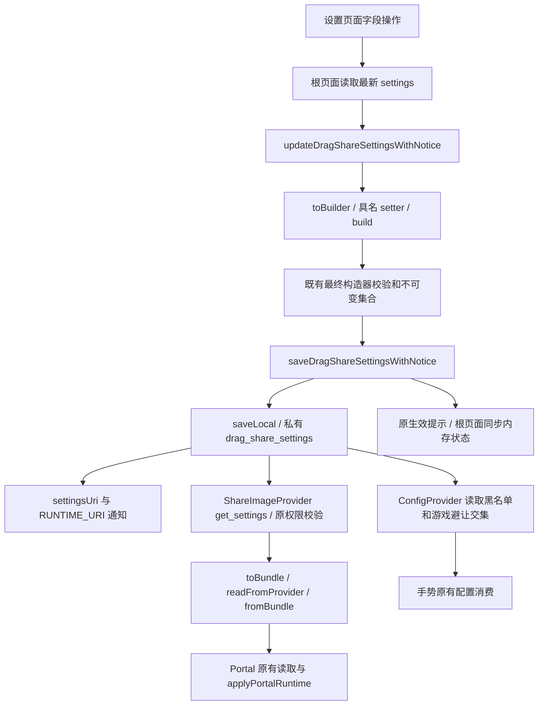

# 配置开发说明

本文说明配置的职责和修改入口；当前提交、验证结果与未完事项只在 [CURRENT_STATUS](CURRENT_STATUS.md) 维护。

## 流转与边界



- `DragShareSettings.java`：字段、默认值、旧构造器、取值归一化、不可变集合、SharedPreferences 和 Bundle 映射。`builder()`从 `defaults()` 起步，`toBuilder()`从现有值起步，`build()`仍委托原最终构造器。不要再维护第二套默认值或范围校验。
- `SettingsEffectNotice.kt`：`DragShareSettingsMutation` 和 `updateDragShareSettingsWithNotice` 是设置界面实际使用的字段更新入口；后者调用原 `saveDragShareSettingsWithNotice`，保存与提示语义保持原样。
- `SettingsScreen.kt`：根回调在每次事件执行时读取最新 Compose 状态，调用更新入口，保存/提示后立即同步状态。子页面传字段操作，不再用捕获的页面快照构造整份配置。
- `ShareTargetSettingsPages.kt`、`ApplicationSettingsPages.kt`：集合增删从 mutation 的 `current` 读取；排序只提交当前编辑结果。显隐、排序、黑名单、游戏名单不会整包覆盖其他设置。
- `ConfigStore`、`ConfigContract`、`GestureConfig` 是独立手势配置体系；只保留现有通知和避让名单交集。Integration/BigBang/LauncherIcon 的独立配置也不并入本模型。

## 修改现有设置

Java 需要复制一个值时：

```java
DragShareSettings next = current.toBuilder()
        .setEdgeTriggerDp(72)
        .build();
```

在已有设置页的 `persist` 回调中：

```kotlin
// 标量：只声明这次变化，根页面负责取最新状态并保存。
persist { _ -> setAccessibilityLongPressTimeoutMillis(900) }

// 集合：从执行时最新集合复制，不用页面捕获的 settings 集合。
persist { current ->
    val hidden = LinkedHashSet(current.hiddenTargetKeys)
    hidden.add(target.key())
    setHiddenTargetKeys(hidden)
}
```

非页面的 Kotlin 调用者可以使用 `updateDragShareSettingsWithNotice(context, current) { ... }`，但须由自己的状态所有者传入最新值并接收返回值；该函数不提供线程锁或跨进程事务。不要把 Builder 长期当作可共享存储。集合 setter 当场复制入参，成品集合仍由原构造器规范化并不可变；setter 后修改外部集合、复用 Builder 都不能改变已构建配置。

## 新增字段或修改默认值

1. 先确认该设置属于哪个存储职责；不是所有设置都属于 DragShareSettings。
2. 若属于本模型：增加字段，在原构造链中指定默认值和必要校验；同步 Builder 字段、源值复制、具名 setter、`build()`参数。保留仍被调用的旧构造器签名，让它们委托既有默认规则。
3. 同步 `defaults()`、`readLocal/saveLocal`、`toBundle/fromBundle` 中确实需要的映射。修改默认值时查清所有缺失字段回退；不擅自改已有 key、类型、合法值或迁移语义。新增跨进程契约应独立评估新旧进程混用，不能借入口整理顺手改协议。
4. 设置目录/页面使用具名 mutation；需要对集合增删时读取 `current`。搜索 ID、导航返回、滑条草稿与完成保存时机保持原约定。
5. 核对 `saveDragShareSettingsWithNotice` 的生效分类、Provider 读取方和真正消费字段的位置。不得仅保存成功就提示运行时已经接收；保持通知 URI 和读写权限。
6. 扩展既有行为测试：默认、非默认对象改单字段保留其余字段、连续修改、读写/Bundle往返、缺失/旧配置、集合所有权和边界。不要使用源码字符串匹配替代配置行为断言。

重点兼容规则包括旧复制目标显隐迁移、旧0时长归一到600ms，以及合法时长250–3000ms。老 Bundle 复制可见性字段和构造器仍为兼容保留，不因新入口删除。畸形显式 null 载荷不等于缺失字段；此类协议加固单列问题，不混入结构整理。

## 验证入口

优先运行 `DragShareSettingsTest`、`SettingsEffectNoticeTest`，再按根 [AGENTS](../AGENTS.md) 执行完整单测、Lint 和 Debug；交付 Beta 时执行实际 Beta/R8。`ConfigUpgradePreservationTest`、`ConfigContractTest`、`ShareImageProviderTest` 等既有合约测试继续保留。

Robolectric能验证模型、保存、Bundle和提示；不能替代真实宿主的 Provider/ContentObserver 接收与运行时生效验收。完整 Miuix 触摸、导航、主题与设备矩阵也须按对应任务验证。
