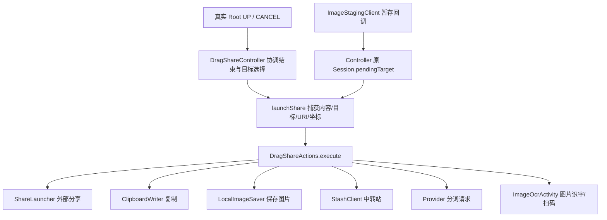

# 拖拽动作执行与资源边界

当前提交、测试结果和功能待办见 [CURRENT_STATUS](CURRENT_STATUS.md)。本文维护代码地图与资源约定。

## 代码地图

- `DragShareController`：输入协调、手势状态、目标查询与选择、等待图片暂存、是否执行动作、当前 Session 的结束标记、预览/菜单/动画/清理。`launchPendingShare`仍先取走旧 Session 的 pendingTarget 再执行；原 staging 回调检查 destroyed/cancelled，不因新会话替换就丢掉已接受的旧动作。
- `DragShareActions`：只分派已选动作并执行原动作代码；构造参数是 Context、控制器原 main Handler、同一 DragShareToast、固定的 accessibility 来源标记。入口接收 `CapturedContent payload, ShareTarget target, Uri stagedUri, float x, float y, String operation`，旧签名兼容包装保留；不持有控制器、Session、当前设置或访问内部字段的回调。operation是可选日志关联，不决定是否执行。
- `ShareLauncher`：文字/图片分享 Intent、按目标包授权和启动失败撤销授权/提示；调用启动成功只表示提交成功，不表示目标已经接收或发送。
- `ClipboardWriter`、`LocalImageSaver`、`StashClient`：继续处理已有平台调用、线程/流和跨进程存储职责，没有新增重复的执行端体系。

## 线程、输入和所有权

| 动作 | 输入与执行线程 | 资源与完成 |
|---|---|---|
| 外部分享 | payload、目标、staged URI；主线程 | 保持ACTION_SEND/MIME/Component/NEW_TASK；图片保持data、EXTRA_STREAM、ClipData、read grant。失败由ShareLauncher按原规则撤销本次目标授权并提示 |
| 复制文字/图片 | 文本或URI；ClipboardWriter原daemon/Root路径，完成回到MAIN | 回调只记日志/提示；Root超时/AppOp/URI导入保持原行为 |
| 保存图片 | 原Bitmap引用；`drag-share-local-save`，main Handler提示 | LocalImageSaver关闭流，失败删除未完成的MediaStore记录/旧目录文件；成功文件归用户 |
| 中转站 | payload和URI；`drag-share-stash-save`，main Handler提示 | Provider打开并关闭暂存图流，StashStore复制为持久文件；动作不删除输入URI |
| 分词 | text/before/after及x/y数值；主线程Provider call | Bundle保存调用数据；仍检查accepted，拒绝/异常提示沿原路径 |
| OCR/扫码 | URI、qr标记；主线程startActivity | 维持显式Activity、hosted_uri、qr、image/*、ClipData与read flag；Activity与overlay接续原输入处理 |

执行器不复制/回收Bitmap，不在完成回调删除文件或撤销成功授权。worker闭包持有本次payload/Bitmap/URI及operation的快照，不回读后来替换的Session。正常手势结束和新手势开始没有新增recycle；原拒绝无物理Root/按压接管分支保持原样。两条链路与阶段上限见 [操作追踪](OPERATION_TRACING.md)，launch返回不等于目标已打开或发送。

暂存文件由模块Provider拥有；导入失败清理tmp，原SharedImageCleanupJob按24小时阈值、12小时任务和导入前清理回收过期文件/授权。该策略不是永久授权或活动动作租约；本批不改变它。中转站持久文件和用户保存的图库图片不属于暂存清理范围。不要为了窗口整理在下一次手势或动作完成时提前删除/撤销已提交动作的数据。

异步完成仅输出原提示，不取消/清理新会话。Controller继续在execute正常返回后按原时机设置传入的shareSession.cancelled；未改成finally，也没有增加重试或全局去重框架。至多一次由原结束协调、pendingTarget清空和staging回调的Session检查保证，execute本身不是可去重的事务入口。

## 修改与验证

### Exit / Destroy Resource Ownership

窗口/面板的创建、持有、异步借用和退出释放点见 [退出资源归属](EXIT_LIFECYCLE.md)。Controller仍协调手势和窗口；动作类未重设计。销毁窗口不能提前释放已接受动作借用的Bitmap、文件或URI。退出清理撤销本窗口的监听/回调，旧回调先核对生命周期和owner，不影响新会话。

新增动作前核对现有ShareTarget与执行工具，明确是否需要URI/Bitmap/坐标及原线程。不能把整个Controller或可随意读取字段的回调交给动作类。窗口生命周期、会话模型和输入权威的变更须另批处理。

`DragShareActionsTest`覆盖真实ShareLauncher/Provider的Intent与grant/revoke调用、剪贴板/中转站与内置目标输入/提示；存图用测试专用工具shadow核对Bitmap、原工作线程和结果。`DragShareActionLifecycleTest`保留真实控制器与动作类，通过可控stage/clipboard边界验证结束、取消、重复旧回调、会话替换与失败隔离。已有`DragSharePreviewLifecycleTest`、`ShareImageProviderTest`、`SharedImageCleanupTest`、`LocalImageSaverTest`、`StashStoreTest`继续保留原断言。

文字分享的Intent需在`startActivity`进入框架之前取快照；框架可能把EXTRA_TEXT自动迁入ClipData。Robolectric环境中的URI权限查询在未grant和revoke后均可能返回允许，不能据此断言系统撤销已生效；本层只确认真实Provider调用Context时的包名/URI/read flags，设备执行结果单列验证。

替身只能证明对应逻辑边界；真实系统grant、目标应用读取/发送、Root剪贴板、AICR与宿主窗口限制仍需设备验证。检查命令见根 [AGENTS](../AGENTS.md)，当前实际结果只在CURRENT_STATUS和当轮交付记录维护。
