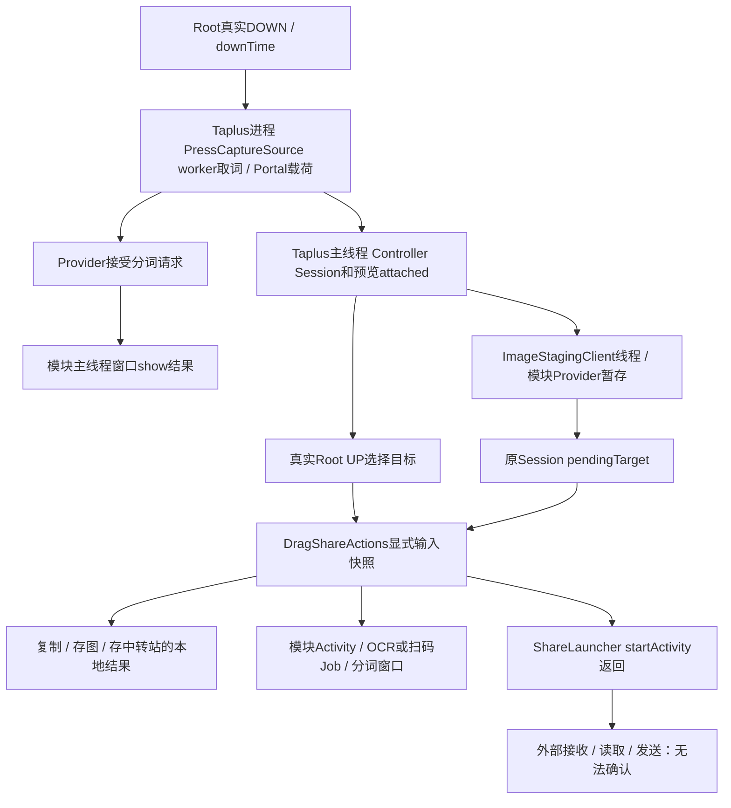
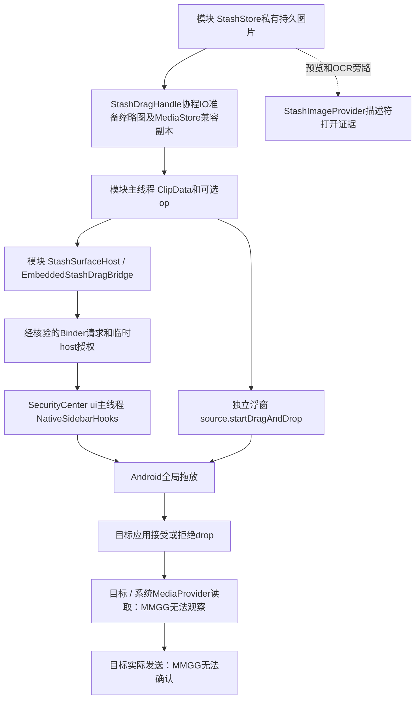

# 操作追踪与完成证据

本文维护两条链路、阶段语义和判读方法。当前提交、验证结果及产品待办只在 [CURRENT_STATUS](CURRENT_STATUS.md) 维护；动作和退出资源地图见 [DRAG_ACTIONS](DRAG_ACTIONS.md)、[EXIT_LIFECYCLE](EXIT_LIFECYCLE.md)。

## 标识与边界

`OperationTrace` 只做可选诊断，不授权、不决定动作执行、不持有资源或维护状态机。沿用 `DragShareLog` 的日志等级、目的地和进程生命周期标识。

- `proc`：现有 logger 的时间＋PID，代表记录事件的进程实例。
- `op`：Root 路径使用 `press-<源进程实例>-<downTime的36进制>`。PressCaptureSource 与 Controller 在同一 Taplus 进程收到同一 Root DOWN，使用同一 ID。没有既有 request 的独立中转站拖拽、旧动作入口和外部图片接收使用一次 UUID。异步闭包捕获本次 ID，不读取后来替换的会话。
- `stage/outcome`：受控阶段和结果，不是全局状态枚举或最终发送回执。同一阶段可在不同进程分别报告请求和接受，不能按关键词数量统计动作次数。
- `asset`：资源地址的 SHA-256 前16字节十六进制指纹；不输出 URI、UUID能力令牌、路径、图像字节或文字内容。相同资源复用时可以对应多个 op，因此 asset 只能辅助关联，不能独自证明由哪次操作访问。

跨边界在现有 Bundle/Intent extras 或 ClipDescription extras 附可选 `mmgg_operation_trace`；保留原正文、条目、已有 extras、URI和权限。缺失、格式异常或无法附加时退为 `-`，继续原功能。Provider stage 旧客户端仍使用原三参数调用：Provider 的 `op=-` 可用返回 URI 的 asset 与 Controller 的 stage 回调关联；没有新增必须字段、RPC、AIDL或权限条件。

新日志不含正文、图片内容、敏感 URI、授权令牌，也不逐条记录 MOVE。边界失败只记录异常类型，不输出可能包含私密地址的异常消息/堆栈。已有调试坐标汇总不作为完成证据，本轮未扩大输入日志。

## 链路一：取词/识图到目标动作



| 阶段/责任方 | 进程、任务 | 数据/资源归属 | 能确认什么、后继未知项 |
|---|---|---|---|
| capture / portal_capture：PressCaptureSource、PortalContentCaptureSource | 注入Taplus；Root/主线程与既有capture worker、AICR回调 | 捕获内容由既有capture/session持有；原generation决定迟到回收 | returned/accepted只表示得到内容；empty不等于权限拒绝；不证明窗口打开 |
| show / preview：Controller | Taplus主线程 | Session持有payload，Controller持有预览/菜单 | accepted与attached表示本地挂窗路径完成；不是首帧或用户看到的确认 |
| stage：ImageStagingClient、ShareImageProvider | 原staging线程 → 模块Binder线程 → Taplus主线程回调 | Provider拥有暂存文件，Session/已选动作借用URI；原TTL回收 | provider_completed/stage completed说明已暂存；不代表接收方打开 |
| target / action：Controller、Actions | 真实UP后主线程；等待stage时原pendingTarget | execute接收payload/target/URI/x/y/op快照；worker只借用本次数据 | selected/started说明目标选择和动作进入；原Session去重/取消继续有效 |
| share：ShareLauncher | Taplus主线程 → 系统Activity启动 | 保持data、EXTRA_STREAM、ClipData、MIME、read grant及失败revoke | activity_requested与activity_launch_returned仅是平台启动调用；不是目标已打开、已读取或已发送 |
| clipboard / local_save / stash | 原ClipboardWriter线程/回调、存图与StashClient线程 | 保持Bitmap、流、持久文件与URI原ownership | completed只限原本地API/写入结果；不能推广为外部应用发送完成 |
| text_window / image_activity / image_window / image_ocr | 模块Provider/Activity → main.post → 既有decode/识别Job | 窗口与Job各自持有；退出guard和Bitmap释放见退出地图 | accepted是排队；shown是window.show返回；received是Activity入口；result_available是识别结果可用，均不表示最终发送 |

取消/迟到：原generation、cancelled、destroyed、LatestRequest和owner guard不变。stage的late_ignored保留旧op且不发起动作；已进入execute的动作允许在原窗口退出和新手势期间继续。仅选中目标、仍待stage的会话不等同已进入执行器，销毁仍按原规则丢弃迟到回调。没有新增超时/重试；只在原失败回调或异常实际到达时记failed。后继事件未出现时保留未观察到，不能自行认定超时。

## 链路二：中转站图片到接收方访问



| 阶段/责任方 | 任务和资源归属 | 完成条件与限制 |
|---|---|---|
| drag_prepare / asset_ready：StashDragHandle、StashDragImageCache | 模块Compose scope及IO；StashStore仍拥有原图；兼容Downloads副本与缩略图沿用原清理策略 | prepared资源可用才派发；松手、detach或scope取消抑制交接；abandoned不删除持久原图 |
| drag_dispatch：Shelf独立/嵌入入口 | 主线程，ClipData借用URI和shadow；不新增资源owner | accepted_dispatch只说明入口接受派发；嵌入路径尚需host回调，不能当native已开始 |
| module_host_drag_request / uri_grant / host_drag_request | 模块StashSurfaceHost/Bridge → 原Binder请求；维持已核对SecurityCenter UID/包、shadow能力回退 | requested/granted不是drop；拒绝、host异常、abort独立记录，原grant/revoke不变 |
| native_drag_start / native_drag_end | SecurityCenter `:ui`主线程；host持有shadow和本次callback | native start返回与实际END分别记录；drop_accepted只是Android结果；主动release是end_not_observed_abort |
| source_drag_* / module_drag_* / bridge_drop_result | 原独立observer或Binder回调 → 模块main Handler | false可能是拒绝/取消/abort；不能强行归因；END先于START时只记resolved_from_end_unknown，保留既有callback顺序。Shelf的reported_true/false只表示回调值，可能来自上述补发，不能替代host的native_drag_start证据 |
| image_access：ShareImageProvider / StashImageProvider | 模块Binder；PFD交由调用方关闭；原权限检查保留 | descriptor_opened在PFD成功创建后才记录；metadata_query和mime_query不是读取。`read=unknown delivery=unknown`明确边界 |

**兼容性事实**：实际中转站拖图使用 `StashDragImageCache.uri()` 创建/复用的 MediaStore Downloads副本。目标读取通常由系统MediaProvider处理，MMGG自己的Provider没有openFile事件完全可能是正常路径。StashImageProvider主要服务预览/OCR旁路；不能为了多收日志把兼容副本改回私有Provider，也不能据此收紧显式grant/系统转发。

Bridge按原generation忽略迟到与重复callback；abort和deferred close仍按原顺序收尾。已接受拖拽期间关闭请求继续由原机制延后；未新增Binder回调超时。缺少callback日志可由日志关闭、进程退出或采集缺口造成，不能单凭缺日志认定失败。

## 判读：最后确认阶段

1. 先按proc区分进程实例，按op聚合阶段；跨进程不要仅按导出文件行序或墙钟时间推导因果。
2. 有明确failed/rejected/aborted事件：报告该边界失败/拒绝/终止，不扩大为所有功能失败。
3. 有activity_launch_returned或drop_accepted，但无接收端回执：最后确认到启动返回或drop接受；读取/发送无法确认。
4. 只有requested而无后续：后续未观察到。日志缺失/关闭不直接等同功能失败。
5. descriptor_opened只证明描述符打开；没有逐字节观测，不能写“已读取完整图片”。asset复用或op缺失时保留归因歧义。

以下为**合成示例**，不是实机采集，不含用户内容或真实资源地址：

```text
proc=taplus-example op=press-taplus-example-1 stage=stage outcome=completed asset=0123456789abcdef0123456789abcdef
proc=taplus-example op=press-taplus-example-1 stage=share outcome=activity_requested asset=0123456789abcdef0123456789abcdef
proc=taplus-example op=press-taplus-example-1 stage=share outcome=activity_launch_returned asset=0123456789abcdef0123456789abcdef
proc=module-example op=- stage=image_access outcome=descriptor_opened asset=0123456789abcdef0123456789abcdef callerUid=12345 read=unknown delivery=unknown
```

可报告：本次启动调用返回，且同asset的描述符被打开；实际读取/发送无法确认，asset复用时访问归因也有歧义。若最后一行为缺失，只能报告未观察到MMGG Provider访问，尤其不能据此判定MediaStore拖放失败。

```text
proc=module-example op=stash-example-2 stage=bridge_abort outcome=aborted asset=-
proc=module-example op=stash-example-2 stage=host_drag_end_callback outcome=stale_ignored asset=-
proc=module-example op=stash-example-3 stage=bridge_drop_result outcome=accepted asset=-
```

可报告：旧操作已abort，旧迟到回调被忽略；新操作的drop被接受，发送仍未知。不要把旧回调记到新操作。

## 验证入口与后续实机清单

微信来源判断另记录固定枚举：`capture_kind`区分wechat/other、文字/图片及PORTAL_MEDIA/SCREEN_CAPTURE/UNKNOWN；`image_drag rejected_*`保留拒绝阶段与来源，`portal_capture`保留缺少载荷、位图引用不符、读取失败或接管结果。事件只在捕获/动作边界产生，不逐MOVE记录。Portal适配器无现有操作ID时使用`op=-`，不能仅凭时间相近强行归到某次按压。缺少Portal事件也不能证明宿主没有返回；需核对日志是否覆盖该进程及完整操作。

这些固定字段可进入诊断ZIP；原始自由日志仍过滤，不为排查微信导出正文、图片或URI。参考源码和原图/裁剪图边界见[微信图片参考对照](WECHAT_IMAGE_REFERENCE.md)。

`OperationTraceTest`验证可选metadata、内容/extras不变、日志关闭、隐私过滤、进程/操作分离与描述符证据上限。Actions、ActionLifecycle、Bridge、Provider及前轮退出测试覆盖原功能与失败、重复、乱序、取消迟到、关窗后的已接受动作。完整命令和本轮结果见CURRENT_STATUS；Robolectric不证明系统URI权限真的授予/撤销。

本轮不操作设备；后续用户实机回归最小清单：

- 文字/图片分别拖向复制、存图、中转站、分词、OCR/扫码与外部目标，确认原结果和提示。
- 独立与安全中心中转站各拖一张图至微信/QQ：分别确认native启动、drop接受、目标展示、用户最终发送，不把这些合成一个“成功”。
- 取消/快速新开、准备图片时关窗、已执行复制/存图后关窗；旧结果不覆盖新窗口。
- 开/关诊断各跑一次，功能一致；导出日志不含正文、图片、URI或令牌。未观察到的阶段据实标记，不补造结论。
