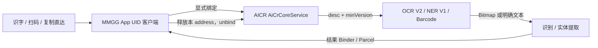

# 小米 / 澎湃系统文本、OCR、NER 与条码接口复用手册

本文是 MMGG 中可复用的系统文本识别相关入口索引和调用指南。以当前源码为准；接口证据和目标 ROM 验证分开陈述。本文不是 Xiaomi SDK，也不承诺跨所有 HyperOS / AICR 版本兼容。

## 快速选择

| 需求 | 采用接口 | 传入内容 | 返回 | 适用边界 |
|---|---|---|---|---|
| 从已获得的 Bitmap 识别文字 | `AicrOcrClient` → AICR `IVisionService` V2 | Bitmap | 全文，或全文加行文字与原始坐标 | 目标设备需实际提供 OCR V2；没有隐式引擎回退 |
| 从已有字符串提取电话、网址、位置等实体 | `AicrNerClient` → AICR `INerService` V1 | 显式传入的字符串 | 实体文字、类型、原文偏移 | 客户端不会读取剪贴板，但文本会发给 AICR |
| 从已获得的 Bitmap 识别二维码/条码 | `AicrBarcodeClient` → AICR `IBarcodeService` | Bitmap | 去重且保持返回顺序的码值 | 不使用 OCR 的 V2 版本查询；Core 插件申请版本为空字符串 |
| 将文本拆成词与字素安全的片段 | Android ICU `BreakIterator` | 字符串 | UTF-16 原文范围 | Android 平台 API；词典随系统版本变化，不是 Xiaomi Binder 服务 |
| 从传送门当前按压内容取得文字/图片 | `PortalHooks` / `PortalContentCaptureSource` | Portal 当前会话 | 带来源标记的文字或 Bitmap | 这是 Taplus 内容捕获 Hook，不负责 OCR/条码识别 |

系统翻译 SDK 是另一条未接入的接口研究，见[小米翻译接口调查](XIAOMI_TRANSLATION.md)；不要把它当作 OCR、NER 或上述客户端的回退引擎。

## 共同 AICR Core 连接

三个 AICR 客户端都以应用自身 UID 直接绑定：

```text
package:   com.xiaomi.aicr
service:   com.xiaomi.aicr.access.AiCrCoreService
action:    com.xiaomi.aicr.access.AICR_ENGINE
extra:     bind_type = 本次请求唯一 address
descriptor: com.xiaomi.aicr.IAiCrCoreService
```

典型次序是：应用 UID bind → 等 `ServiceConnection` → 校验 Core descriptor → Core transaction 1 请求某个插件并读取 Binder / `Bundle.Status` → 执行插件协议 → Core transaction 2 释放本次 address → unbind → 主线程回调。

每次请求必须新建自己的 address，只释放自己申请的连接。不要强停 AICR、释放其他客户端会话，也不要用 Root UID 成功替代模块普通 UID 的可用性验证。Binder 调用是同步事务时，设置取消标记并不能中断正在执行的远端调用。



### 版本和能力判断

- `CompatibilityReport` 可报告 `com.xiaomi.aicr` 包的已安装版本名/版本号，并同时报告 Portal 包版本。这是环境摘要，不是 OCR 能力探测。
- MMGG 提供默认关闭的全局兼容开关，复用 AICR 专用 Provider 设置 RPC。开启时只将 AICR Core `onTransact` 调用中普通应用 UID 对 system UID 的签名比较视为通过；未开启时沿用仅 MMGG 的既有兼容。此 Hook 不会跳过插件 `Status`、V2/V1、能力、模型或其他权限检查；因此不能保证所有应用在所有 ROM 都能调用成功。Provider 设置无法读取时保留系统原签名判断。
- OCR 的实际运行时核验发生在插件请求：Core 返回 `Status` 和 Vision Binder 后，客户端核对 interface descriptor，再调用 Vision transaction 6 `getOCRVersion()` 并要求返回 `V2`。
- NER 在 Core 插件申请时传 `V1`；当前客户端核对 Binder descriptor 和 Core `Status`，没有独立版本查询事务。
- Barcode 在 Core 插件申请时传空字符串；客户端核对 descriptor 和 `Status`，没有 `getOCRVersion()` 步骤，也不能照搬 OCR 的 `V2` 参数。
- 静态 AICR 接口资料记录 Core 还有 `isSupport(desc)` 事务 3；当前这三个生产客户端不把它当作 OCR/NER/Barcode 的前置判据。诊断包中有 AICR 版本，不能据此声称某能力可用；真正能力仍以对应插件调用结果为准。
- 不同插件的状态文案与状态映射可能不同。不要把 OCR Status 7 直接复用为条码或 NER 的产品结论，也不要从用户看到的一句话反推 AICR 实际返回了哪一个 Status。

## Hook AICR：边界选择与抗混淆维护

本节说明 MMGG 当前如何在 AICR 进程里安装有限范围的 Xposed Hook，以及 AICR 内部符号变化时如何维护。目标是让一处已确认的 Core 调用兼容检查可以被诊断和局部适配；它不能阻止小米对 AICR 混淆，也不能保证未来所有版本都不需要更新。

### 当前 Hook 的安装与命中路径

入口位于[`MainHook.java`](../app/src/main/java/com/leaf/hyperdragshare/codex/MainHook.java)：只在 `com.xiaomi.aicr` 包加载时调用 `AicrCoreAccessHooks.install()`。因此这段 Hook 不会在普通 App 或全系统进程普遍改写 `PackageManager` 行为。当前 Hook 目标是 Android framework 的 `ApplicationPackageManager.checkSignatures(int,int)`，而不是 AICR 的混淆私有方法。

安装后先 Hook `Application.attach(Context)`，保存 AICR 进程自己的 `ContentResolver`，用于读取模块设置；若安装失败或还没有 resolver，全球兼容分支按关闭处理。随后 Hook framework 的两个 `int` 参数重载。Hook 只在以下证据全部吻合时考虑返回兼容结果：

1. `Binder.getCallingUid()` 是普通应用 UID 范围，且 `PackageManager.getPackagesForUid(uid)` 返回了包名；查询失败、空列表或系统/隔离 UID 不进入兼容分支。
2. `checkSignatures` 的第一个参数等于 Binder 调用 UID，第二个参数等于 Android `SYSTEM_UID`。
3. 当前调用栈包含 AICR Core Binder `AiCrCoreService$…onTransact`。
4. 如果调用 UID 所属包包含 MMGG，则沿用既有 MMGG 专用兼容；否则必须从已有受限 `get_aicr_settings` RPC 读到用户已开启全局开关。

任一条件不满足时不调用 `setResult`，让 Android 执行原签名比较。设置读取异常、Provider 不可用、AICR Context 未就绪、返回 Bundle 缺失或开关键缺失都等同关闭；不会因为诊断或设置读取失败而扩大授权。全局设置只让这个精确比较返回 `SIGNATURE_MATCH`，不是对 AICR 所有白名单、插件授权或系统接口的总开关。

```text
MainHook(AICR package)
  └─ AicrCoreAccessHooks.install()
       ├─ Application.attach → retain this process ContentResolver
       └─ ApplicationPackageManager.checkSignatures(int, int)
            ├─ check Binder UID + installed package evidence
            ├─ check requestedUid == Binder UID
            ├─ check comparedUid == SYSTEM_UID
            ├─ check AICR Core onTransact stack
            └─ MMGG caller OR protected setting enabled → return SIGNATURE_MATCH
               otherwise → keep platform result
```

核心实现：[`AicrCoreAccessHooks.java`](../app/src/main/java/com/leaf/hyperdragshare/codex/AicrCoreAccessHooks.java)、设置持久化：[`IntegrationSettings.java`](../app/src/main/java/com/leaf/hyperdragshare/codex/IntegrationSettings.java)、受限 Provider：[`ShareImageProvider.java`](../app/src/main/java/com/leaf/hyperdragshare/codex/ShareImageProvider.java)。不要把该开关复制进公开配置 Bundle，也不要为它新增无调用者校验的 Provider 方法。

### 混淆能做什么，不能做什么

- **不能阻止供应方混淆。** AICR 是独立系统 APK；MMGG 无法控制它的 R8/ProGuard 配置、类名、方法名、字段名、内部 Binder 类或后续代码重排。所谓“防混淆”在这里指降低 Hook 对这些实现细节的依赖，并让变化后明确退回原行为。
- **优先选择稳定边界。** 如果目标逻辑最终调用 Android framework API，优先 Hook framework 边界，再用调用进程、Binder UID、参数、包名与调用栈收窄范围。不要只凭“某个类名存在”或某个进程启动，就假定是目标功能。
- **仍需承认当前残余依赖。** 当前代码避开了 Beta27 中误用的 AICR 私有 helper 名，但用 `AiCrCoreService$` 类名前缀识别 Core `onTransact`。若未来 AICR 改包名或混淆 Core 服务类，这个谓词会不命中并安全地保留系统结果；它不是完全免维护的动态 Hook。
- **先用 DEX 描述符确认名字。** JADX 为便于阅读生成的包名不一定等于 DEX 中的真实类名。例如历史调查中，显示为 `defpackage.u8` 的类在 DEX 里是根包描述符 `Lu8;`。Xposed 的 `ClassLoader` 查找应使用运行时二进制名和目标 APK 的 ClassLoader，不要直接复制 JADX 左侧展示路径。先检查 DEX descriptor、运行时 `Class.forName(name, false, aicrLoader)` 与方法参数/返回类型，再决定精确 Hook 点。
- **动态发现不能靠宽泛猜测。** 可以在已确认的 AICR ClassLoader 内枚举候选类，再按 Binder descriptor、接口方法签名、`onTransact` 参数及调用行为做验证；必须要求唯一候选并保留否定路径。不要“Hook 第一个名字像 OCR 的类”、遍历整个系统安装包或因找不到类就放宽到所有调用者。R8 也可能改变代码结构或内联逻辑，所以即便名称被动态找到，仍要验证实际行为。
- **需要混合策略时分层。** 方法存在性/参数签名作为 Hook 安装能力探测；框架参数和 Binder caller 作为授权谓词；Core descriptor、事务号、插件 descriptor、Status 与版本作为协议核验。任一层缺失时记录受控的阶段和错误类别，保留原逻辑。不要用反射成功代替服务能力成功。

### 版本变化时的维护步骤

1. **固定样本与版本。** 记录 ROM build、AICR `versionName/versionCode`、APK SHA-256、目标进程包名与模块版本；不把“版本号相同”当作实现相同。
2. **先比接口边界。** 对照 Core service component/action、Binder descriptor、事务号、参数顺序、响应 Bundle、插件 descriptor/minVersion。使用可读伪代码和 DEX descriptor 对照，不直接把反编译 Java 类当 SDK。
3. **核对 Hook 入口。** 确认 framework 方法在当前 Android 版本仍存在且签名匹配；确认 Hook 在正确的 AICR ClassLoader/进程安装。再核验 Core Binder 栈谓词。Hook 没安装、没命中和命中后 AICR 拒绝是不同故障阶段。
4. **按最小矩阵验证。** 至少测：开关关闭时 MMGG 既有路径；开关开启时普通 App UID 的精确 Core 比较；其他 PackageManager 签名查询不变；系统/隔离 UID 不被放行；AICR Status、接口版本、能力、图片传入和结果读取仍能分别失败并显示正确原因。
5. **让 Hook 失败时可见但安全。** 只记录 Hook 安装/命中/未命中、受控 UID 类别、AICR 阶段和异常类型；不记用户正文、图片、敏感 URI、令牌或任意异常消息。若谓词或设置无法核实，继续原生路径，不做宽泛回退。
6. **独立记录兼容结论。** 写明具体 APK/ROM 和测试层级。静态 descriptor 一致、单测通过、模拟环境通过、真实设备观察是不同证据；不能从某一版本的一次成功推广到任意未来版本。

当前 Hook 的边界测试位于[`AicrCoreAccessHooksTest.java`](../app/src/test/java/com/leaf/hyperdragshare/codex/AicrCoreAccessHooksTest.java)，设置 Provider 测试位于[`ShareImageProviderTest.java`](../app/src/test/java/com/leaf/hyperdragshare/codex/ShareImageProviderTest.java)。若以后把类名前缀谓词改成动态 Core 识别，应先新增能证明“唯一识别正确 Core 且错误候选不触发”的行为测试，不要仅删除类名后让全局签名比较都命中。

## 图片文字识别：AICR Vision V2

实现：[`AicrOcrClient.java`](../app/src/main/java/com/leaf/hyperdragshare/codex/AicrOcrClient.java)、[`AicrV2ResultReader.java`](../app/src/main/java/com/leaf/hyperdragshare/codex/AicrV2ResultReader.java)、[`AicrOcrResult.java`](../app/src/main/java/com/leaf/hyperdragshare/codex/AicrOcrResult.java)。产品调用边界见[图片与屏幕识字](IMAGE_OCR.md)与[OCR 连接诊断](OCR_CONNECTION_DIAGNOSTICS.md)。

### 调用协议

Core transaction 1 `getPluginBinder` 参数顺序：

```text
ICoreServiceCallback Binder
address String
com.xiaomi.aicr.plugin.IVisionService String
V2 String
```

返回插件 Binder 和包含 `Status` 的 Bundle。拿到插件后，先核对 descriptor 为 `com.xiaomi.aicr.plugin.IVisionService`，再按以下顺序调用：

| Vision transaction | 含义 | 参数 / 返回 |
|---|---|---|
| 6 | 查询 OCR 接口版本 | 返回 String，当前实现必须是 `V2` |
| 1 | `setImage` | 写 typed `Bitmap`，返回图片 session 整数 |
| 3 | `doOCRDetect` | 写 session；返回检测行数，负数表示 session 无效，0 表示没有检测到文字 |
| 4 | `doOCRRecognize` | 写 session；返回 AICR OCRResult typed Parcel |

执行顺序必须保持 `version → setImage → detect → recognize`。当前实现没有用 Vision transaction 2 的 PFD 图片入口。不得省略检测、猜测另一个版本的字段布局，或在坏 Parcel 后扫描原始字节“找文字”。

### 结果和返回格式

`AicrV2ResultReader.readResult` 在 Binder exception header 后先读取 Parcelable presence marker，再依次消费 paragraphs 中的行、字符和坐标、段落文字、`total_text` 及 entities。位置对象必须是当前已识别的 `com.xiaomi.aicr.vision.ocr.OCRRes$Location` wire type；每行保留原始 polygon/box 数组，不在协议层把坐标猜成屏幕坐标或改成 LTRB。

常见客户端错误状态见 `AicrOcrClient.statusMessage`：0 成功；1 首次模型准备；2 版本不匹配；3 服务断开；4 服务错误；5 没有引擎；6 图片传入失败；7 当前 OCR 能力不支持；8 权限拒绝。`Status` 缺失、Binder 为空、Vision descriptor 不符、V2 不符、图片 session 无效、检测为空、结果 Parcel 格式错，都是不同阶段，不能统称成“没有安装 AICR”。

### Kotlin / Java 调用示例

```java
AicrOcrClient.Request request = AicrOcrClient.recognize(context, bitmap, (text, error) -> {
    // 回调在主线程；完成 Core release/unbind 后只回调一次。
    if (error != null) showFailure(error);
    else showRecognizedText(text);
});
// 窗口关闭时可 request.cancel()；同步 Binder 不会因此立刻中止。
// 调用方持有 Bitmap 至回调完成（包含 cancel 后的最终回调），不要提前 recycle。
```

需要结构行结果时调用 `recognizeWithLines`，使用 `AicrOcrResult.text` 与 `lines`；兼容全文调用仍由 `recognize` 提供。当前 `ImageOcrOverlay` 图片入口先将软件 Bitmap 的最长边限制为 4096px，再调用客户端；屏幕/区域路径由 `ScreenOcrSession` 管理截图与取消。

同进程 AICR OCR 客户端一次只接受一个活动请求；繁忙请求明确失败，不排队。连接等待为 15 秒，但它不构成同步 Binder 调用的硬超时。取消结果会被抑制，直到在途事务返回、连接释放、解绑后完成回调。客户端不回收调用者的 Bitmap，也不自动切换另一个 OCR 引擎。

## 字符实体提取：AICR NER V1

实现：[`AicrNerClient.java`](../app/src/main/java/com/leaf/hyperdragshare/codex/AicrNerClient.java)，当前消费方包括[`CopyDirectSuggestions.kt`](../app/src/main/kotlin/com/leaf/hyperdragshare/codex/CopyDirectSuggestions.kt)。

通过同一个 Core 连接申请 descriptor `com.xiaomi.aicr.plugin.INerService`，minVersion 为 `V1`。Core 返回成功状态和 Binder 后，NER transaction 1 接收一个 String，返回包含实体条数及每个实体的 presence marker、text、type、start、end 的 Parcel。当前支持类型常量包括 LOCATION、ID、TEL、BCN、TRAIN、FLN、CAR、ORDER、ENO、MAIL、URL、TAX_ID。

调用方应显式传入待提取字符串。`AicrNerClient` 不读剪贴板、不自动重试、不切其他引擎；但原文会作为 Binder 参数发送给 AICR。结果 offset 对应服务返回的输入文字偏移，消费前应使用原输入核对范围，不要对已变换文字直接套用。

## 二维码 / 条码：AICR Barcode 插件

实现：[`AicrBarcodeClient.java`](../app/src/main/java/com/leaf/hyperdragshare/codex/AicrBarcodeClient.java)，图片浮窗入口见[`ImageOcrOverlay.kt`](../app/src/main/kotlin/com/leaf/hyperdragshare/codex/ImageOcrOverlay.kt)。

Core transaction 1 参数为 callback Binder、address、`com.xiaomi.aicr.plugin.IBarcodeService`、空字符串版本。读回 Binder 与 Bundle `Status` 后，核对 descriptor `IBarcodeService`。该接口没有 OCR 的 `getOCRVersion()`。插件事务：

| Barcode transaction | 含义 | 参数 / flags |
|---|---|---|
| 1 | 注册结果监听 | listener Binder、address；同步 |
| 3 | 提交图片 | typed `Bitmap`、address；oneway |
| 2 | 注销监听 | address；oneway |

`IBarcodeResultListener` callback transaction 1 返回 typed `BarcodeBean` 列表。客户端按 wire 顺序消费 valueType、rawValue、cornerPoints、Rect、barcodeFormat，只将非空码值去重并保留服务顺序返回 UI；它不加载 AICR 私有 Java 类。

Barcode 当前状态映射包括：1 模型准备、2 插件版本不匹配、7 不支持扫码、8 权限拒绝。每个完成/取消/失败路径应注销本请求 listener、向 Core 释放 address 并 unbind；复用现有 Request 生命周期，不要从 OCR 客户端复制状态映射或合并成一个跨插件状态表。

示例：

```java
AicrBarcodeClient.Request request = AicrBarcodeClient.scan(context, bitmap, (values, error) -> {
    // 回调在主线程并在清理后到达。空列表代表没有码值；error 代表失败。
    if (error != null) showFailure(error);
    else showCodes(values);
    // 调用方此前持有的 Bitmap 到此回调时才可释放。
});
// 窗口关闭：request.cancel()；仍不要提前释放传入的 Bitmap。
```

当前图片浮窗的扫码入口使用 AICR `IBarcodeService`，不是 ZXing 本地解码；结果可沿用既有链接、Wi-Fi 等消费界面。协议细节只解释当前源码，不意味着所有二维码格式或 AICR 版本均已验证。

## Android ICU：文本分词

实现：[`TextSegmenter.java`](../app/src/main/java/com/leaf/hyperdragshare/codex/TextSegmenter.java)。使用 `android.icu.text.BreakIterator` 的 `Locale.ROOT` word boundary，并以 character boundary 对齐范围，避免拆开组合重音、代理对、肤色修饰符或 ZWJ emoji。

返回范围是原始 String 的 UTF-16 inclusive end，词范围与 `-1` 分隔的标点/字素范围组合，空白保留在原文而不是变成选词块。它不是 jieba，也不绑定 AICR；系统 ICU/词典版本变化可能改变分词边界。需要稳定、可指定词典的跨 Android 分词时，必须另选并评估独立词典库，不要把本接口描述成 Xiaomi 云服务。

## Portal 内容捕获：识别前的来源适配

`PortalHooks` 在 `com.miui.contentextension` 进程适配传送门现有 `TextContentExtensionService` 回调；[`PortalContentCaptureSource.java`](../app/src/main/java/com/leaf/hyperdragshare/codex/PortalContentCaptureSource.java) 读取该次会话文字或与当前图片模式匹配的 Bitmap，并创建带来源标记的 `CapturedContent`。图片为避免 Portal `cancelTask()` 回收宿主缓存，会建立独立 snapshot。Portal 捕获的结果随后交给 MMGG 已有拖拽、暂存或 OCR 路径。

这段逻辑是特定 ROM 应用的 Xposed Hook / 私有宿主字段适配，不是公开 OCR Binder，也不负责识别图片。Root evdev 是另一条按压输入权威；Root 截图是明确的屏幕/区域捕获能力；两者都不应被写成 Portal 自带 OCR。Portal 类名、字段与生命周期属于版本适配点，需根据目标 ROM 源码/运行证据维护，不要为了复用图片识别而在此层再加一套 AICR 客户端。

## 日志、安全与复用检查清单

- 不记录 OCR 原文、NER 输入文本、Barcode 原始码值、图片、Bitmap 内容或识别结果全文。按项目现有诊断只记录请求阶段、受控状态类别、耗时和计数。
- URI 若涉及暂存/分享，沿用调用路径现有 URI 权限和资源 owner；本页 AICR 客户端收的是调用方已经解码的 Bitmap/String，不代替文件访问授权。
- AICR 插件申请、同步 Binder、listener 与 Core address 都是请求级资源。正常完成、取消、异常、窗口关闭和迟到结果均复用各客户端既有 cleanup 与 generation/owner 逻辑，不自行提前 recycle/close。
- 不将 Status 7、Null Binder、版本不匹配、图片拒绝、空识别结果和 Parcel 解码异常合并为一个“组件没安装”提示。
- 不扫描应用列表、不自动启动/更新 AICR、不提高权限、不强杀系统服务、不重试其他客户端的连接，也不在失败时静默回退到旧模型。
- 新增调用前依次核对：服务组件与 Core descriptor；插件 descriptor/minVersion；响应 Bundle 中 `Status`；插件自身版本查询（若该协议有）；Parcel wire 格式；Bitmap/String 所有权；同步 Binder 的取消与超时边界；失败阶段的用户提示与安全日志。

## 证据与兼容范围

- 当前协议事实来自生产源码及对应 wire reader/客户端测试；旧协议分析过程保存在[AICR OCR 可行性记录](AICR_OCR_FEASIBILITY.md)，诊断事件语义见[OCR 与按压连接诊断](OCR_CONNECTION_DIAGNOSTICS.md)。历史报告中的“未接入”“待实测”只描述当时版本，不覆盖当前源码。
- 项目已记录目标小米 15 Pro / HyperOS 4.0.0.17 / Android 17、AICR 4.12.26 上普通 App UID 的 OCR V2 合成图和产品路径验证；条码普通 UID 协议也有该 AICR 样本的静态 wire 证据和项目验证记录。它们不是对其他 ROM、其他 AICR 版本或所有图片的兼容承诺。当前设备/候选的确切结果以[当前状态](CURRENT_STATUS.md)和[设备验证](DEVICE_VALIDATION.md)为准。
- AICR 状态和版本变化可能改变可用能力；版本名相同只说明 PackageManager 报告相同版本，不等于模型、插件、权限或服务进程正常。
- 协议实现不得拷贝或打包系统 APK 的反编译类、私有模型或模型文件。客户端使用独立 Binder/Parcel 适配；遇到新版本不匹配时先保留清晰失败，再以真实协议证据更新测试和文档。
