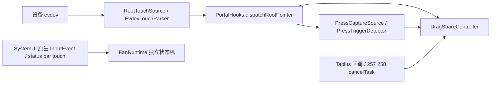

# 长按菜单与拖拽：第一阶段诊断

本阶段只加入观察日志，未修核心状态机、未调整阈值、未新增宿主 App Hook。版本、提交和真实验证见[当前状态](CURRENT_STATUS.md)。正常/异常 App 的成对设备采样尚未获得，不能把源码候选认作微信现场根因。

## 1. 完整事件入口



- 物理输入：[RootTouchSource](../app/src/main/java/com/leaf/hyperdragshare/codex/RootTouchSource.java) `runLoop/readInputEvents/onRawFrame`，经[EvdevTouchParser](../app/src/main/java/com/leaf/hyperdragshare/codex/EvdevTouchParser.java) `consume/emitFrame`输出DOWN/MOVE/UP/CANCEL。
- 分发：[PortalHooks](../app/src/main/java/com/leaf/hyperdragshare/codex/PortalHooks.java) `dispatchRootPointer`先送Controller，再送Press；Root真实UP/CANCEL仍决定活动拖拽结束。
- 长按：[PressCaptureSource](../app/src/main/java/com/leaf/hyperdragshare/codex/PressCaptureSource.java) `handlePointer/classifyPress/firePress/lookup/display`，使用现有[PressTriggerDetector](../app/src/main/java/com/leaf/hyperdragshare/codex/PressTriggerDetector.java)时长/位移规则。
- 拖拽：[DragShareController](../app/src/main/java/com/leaf/hyperdragshare/codex/DragShareController.java) `acceptPointerEvent → handleMotionOnMain → handlePointerOnMain → finishGestureOnMain/cancelGestureOnMain`。
- SystemUI：[FanFreeformHook](../app/src/main/java/com/leaf/hyperdragshare/gestures/xposed/FanFreeformHook.java)的原生InputEvent及status-bar/control-center `dispatchTouchEvent`，经[FanRuntime](../app/src/main/java/com/leaf/hyperdragshare/gestures/xposed/FanRuntime.java) `postMotionEvent/onMotion/handleMotion`；[FanTriggerCapture](../app/src/main/java/com/leaf/hyperdragshare/gestures/xposed/FanTriggerCapture.java)及[OutsideTouchCapture](../app/src/main/java/com/leaf/hyperdragshare/gestures/xposed/OutsideTouchCapture.java)承担既有捕获/透传。它们不是微信View Hook。
- 局部交互：[CustomScrollView](../app/src/main/java/com/leaf/hyperdragshare/codex/CustomScrollView.java) `onInterceptTouchEvent/onTouchEvent`、[SwipeSelectView](../app/src/main/java/com/leaf/hyperdragshare/codex/SwipeSelectView.java)、BoomChipPage、Fan/Honeycomb/SideWheel/TaskSwitcherOverlayView、PointCaptureOverlay及StashOverlayPanel的触摸处理，属于模块面板/窗口内部，不能据此推断宿主RecyclerView或父View是否intercept。

完整匹配位置和停止调用点保存在本轮任务`work/event-locations.txt`、`work/stop-locations.txt`，详见交付记录。新增日志没有扩大原Hook包名/类/方法范围。

## 2. 当前状态机

主拖拽没有一个名为IDLE/PENDING/DRAGGING的统一枚举；它以`active/session/rootDownTime/pressPipelineDownTime/pressHandoffTime`与Press检测器共同驱动。日志给出这些现有事实的投影，不创建第二套控制状态：

```text
IDLE → Root DOWN/PENDING → detector.fire/ARMED → active=true/DRAGGING
                                      ↘ 接受文字窗口/HANDOFF
DRAGGING → 真实UP/FINISHED 或 CANCEL/明确退出/CANCELLED → 清理/CLEANUP
```

`HANDOFF`是交互文字窗口接手，不能当成输入通道故障；`WINDOW_CLEANUP`也可能只是同一操作更换预览。SystemUI另有真实枚举`IDLE/ARMED/SIDE_ARMED/CLAIMED/ACTIVE/HONEYCOMB/TASKS_LOADING/TASKS/CANCELLED`，日志保留原名称，不冒充主拖拽DRAGGING。

## 3. 所有停止/取消路径分组

| 路径 | 位置 | 日志/语义 |
|---|---|---|
| Root UP/CANCEL | Controller.handleMotionOnMain / finishGestureOnMain | `root_up`允许原目标动作；`root_cancel`按原规则取消 |
| Portal 257 | PortalHooks.handleCallback / Controller.finishFromControlEvent | Root拥有期间记录DEFERRED并保留旧回放；非拥有期间沿原路径`host_control_257`完成 |
| 宿主cancelTask | PortalHooks.cancelTask hook / Controller.onHostTaskCancelled | Root拥有时DEFERRED；否则原32ms回调仍检查active，停止原因`delayed_host_cancel_task`；无活动时有RESOLVED记录 |
| 输入静默 | Controller.refreshStaleInputWatchdog | 原30秒不变，`stale_input_watchdog_30000ms`，结合lastEventAge判断；旧Session隔离规则不变 |
| 显式退出/替换/异常 | cancelActiveSession、showContentForPressTakeover、destroy、failOverlay | `explicit_cancel_active_session/same_press_takeover/controller_destroy/overlay_failure_*` |
| 物理多指/主指离开 | EvdevTouchParser.emitFrame | 原多触点分支CANCEL并忽略到全部抬起；主指离开按原规则UP。不是宿主发来的MotionEvent CANCEL |
| Root reader结束/停止 | RootTouchSource.runLoop.finally / stop | 对仍按下的流补原有合成CANCEL；明确`root_reader_closed_synthetic_cancel/root_source_stop_synthetic_cancel` |
| Press前置退出 | PressCaptureSource.cancelGesture/readerFailed/stop等 | 撤销检测、请求、缓存和Press pipeline；不等同于活动Controller必然结束。`press_detector_cleanup`仅在确有状态/资源时输出 |
| SystemUI独立手势 | FanRuntime.handleMotion/resetFan/onImeVisibilityChanged | 原CANCEL、IME可见、任务/窗口过渡、配置及任务退出保持；日志有事件状态转移、RESET和IME_VISIBILITY |
| 面板自身 | Overlay close/dismiss、PointCapture、分词/中转站native drag退出 | 使用各自生命周期；不是Root主状态机或前台宿主TouchTarget的直接证据 |

## 4. 是否监听Window focus

基线未发现`hasWindowFocus()==false → stopDrag`或`onWindowFocusChanged(false) → cancelGesture`。新增`hasWindowFocus/hasFocus`只查询**MMGG已附着的previewView**，不触发行为；被动预览本来就是NOT_FOCUSABLE，因此false通常正常。

[PressWindowSnapshot](../app/src/main/java/com/leaf/hyperdragshare/codex/PressWindowSnapshot.java)确实解析WMS当前焦点/遮挡，但用于捕获前的来源和安全核验；焦点/窗口不匹配可能令捕获失败，不等于活动拖拽因失焦退出，不能删掉该安全检查。Fan的任务/IME回调也不是宿主View focus。

## 5. ACTION_CANCEL与现有输入阻断

Root evdev、Portal观察到的MotionEvent、SystemUI InputEvent是不同流。Root parser的CANCEL不会证明微信View收到了CANCEL；反过来微信自身TouchTarget被取消也不会自动停止设备evdev。

[BackgroundTouchBlocker](../app/src/main/java/com/leaf/hyperdragshare/codex/BackgroundTouchBlocker.java)已有`cancelCurrentTouch/monitorGestureInput/pilferPointers`及Root命令回退。Controller的可选后台滚动锁、Press窗口交接会按原路径调用；本轮只记录请求/调用返回，没有新增取消操作。返回成功不等于已观察到宿主CANCEL。

Root只有坐标/触摸尺寸变化才产生MOVE；手指静止时没有MOVE是正常现象。没有MOVE不能直接写成Popup转移TouchTarget。

30秒静默watchdog本身也不是“输入通道已真实失效”的证明；它是既有防残留兜底，若现场恰好30秒停止，需结合reader/物理按压状态验证，不直接移除。

## 6. 正常与异常App的关键差异：目前能证明什么

尚无本轮正常/异常App成对输入记录。用户前一份ZIP明确为Beta20/262，只有受控操作阶段，没有本轮逐流字段，不能据它选择A/B/C/D。

本轮替身测试**实际复现C类代码竞态**，不是设备菜单复现：

```text
无active时 onHostTaskCancelled 排32ms回调
→ +16ms 新Root DOWN、建立新active session
→ 新session继续收到MOVE，仍active
→ +16ms 旧回调只看active，取消这个新session
→ DRAG_STOP reason=delayed_host_cancel_task
```

正常模拟：MOVE持续时保持active，真实UP才FINISHED；CANCEL按原行为CANCELLED。单纯记录false focus不改变active。真实Popup/Dialog/父View intercept与App菜单出现并没有在这些测试中模拟，不把它们写成已通过。

## 7. 最可能根因与证据优先级

最具体的候选是**32ms延迟回调不绑定其发起时的会话**，已有逻辑层复现；它尚未被用户现场日志命中。其次检查既有BackgroundTouchBlocker是否在故障边界调用、Portal控制消息和Root多指/通道结束、独立Fan的IME/任务reset。纯focus取消没有代码证据。

宿主long-press timer并没有被Root observer取消，菜单可能继续出现；但没有证据证明“菜单→宿主CANCEL→MMGG停止”这整条链。Root DRAG_STOP原因、物理流是否仍继续才是优先证据。

## 8. 推荐最小修改（第二阶段，未实施）

若现场出现MOVE持续却`delayed_host_cancel_task`停止，只修改这个延迟回调的会话归属/代次核验，并在执行时重核Root拥有权；保留既有宿主取消回放和正常退出。增加“旧回调不能结束新Session”的修复断言，再对正常App回归。

若Root源CANCEL/reader结束，先判断多指、选源、生命周期或通道失效，不统一忽略CANCEL。若只有宿主流丢MOVE而Root继续，主拖拽应能独立推进；没有宿主View证据则保留未知，不新增微信内部Hook。若只是focus变化，不添加停止逻辑。

## 9. 哪些历史全局修改应回滚

本轮**没有足够证据建议立即回滚整笔提交**。`1ad1a1d`、`7c3f9b5`涉及阻断/Root快速识别历史，`1c036c1`涉及微信按压/旧MIUI源替换，`e8e217e`使模块覆盖区让出输入，`0435d12`加入30秒兜底。它们是对照检查点，不是已定罪的变更。

如日志证明某条共享分支导致回退，做对应条件的局部调整；不整笔撤回混有其他修复的提交，不撤Root唯一权威、模块自身overlay DOWN避让、捕获安全校验或30秒清理来掩盖问题。触发时长/touchSlop/全局提前intercept和额外CANCEL均未调整。

## 10. 兼容影响与未覆盖范围

| 场景 | 本轮处理与后续验证 |
|---|---|
| 点击 | 原短按条件不改；Debug关闭不输出触摸日志 |
| 长按 | 时长、位移和宿主timer不改；菜单不能直接当作取消 |
| RecyclerView滑动 | 其事件处理未改；现有后台滚动锁的影响仍需对照 |
| ViewPager | 不改拦截/触摸阈值，横向冲突需真实App采样 |
| 文本选择 | 不改ActionMode/选择句柄；微信单消息载荷旧待办保留 |
| PopupWindow | 无菜单检测即取消；宿主TouchTarget未被Hook/直接观测 |
| Dialog | 同上；不要把MMGG preview focus当宿主focus |
| 多指 | 原parser取消规则保留，记录真实物理接触数；Android pointerId未知不伪造 |
| 系统返回手势 | 257/258暂存/抑制/回放和真实UP/CANCEL规则保留 |

没有设备/完整模拟器UI结果。日志增加可控开销，MOVE每通道最多约10Hz；相邻终端与状态不采样。重复空Press cleanup/Fan IDLE reset不借STATE绕过采样，文件和导出仍有原上限。

## 日志开启、字段与导出

在现有“问题反馈与诊断 → 日志设置”手动选择**Debug＋文件日志**，重载本次修改的传送门/SystemUI作用域，再复现并导出ZIP。默认INFO不输出TouchStream，不自动改设置或增加Android权限。SystemUI沿既有受限ConfigProvider.get响应取得两个可选诊断metadata，旧响应缺失时不启用；不增加prefs、功能key或放宽caller校验。文件记录沿用原Root写入通道，进程没有相应访问能力时记录可能缺失，诊断不成为手势运行前提，不据此认定输入消失。

每行包含时间戳、进程实例、channel、packageName、action、downTime/eventTime、x/y/rawX/rawY、dx/dy、pointerId/count、state、dragging、windowFocus/viewFocus、reason、skipped、lastEventAge、gapMs、rawSpace/timeBasis。包名来自本次payload/已知来源，Fan取既有foreground缓存，不另查前台；未知包名保留unknown。

- Root：rawSpace=evdev，timeBasis=read_uptime；Root downTime为首次读取DOWN的时间，非宿主MotionEvent downTime；物理contact数不等于Android pointerId。
- Controller：Root派生事件，raw坐标/pointer信息未传入时unknown；focus只属于MMGG preview。
- Portal callback：仅Taplus属性里实际存在的MotionEvent；不是任意App.dispatchTouchEvent观测。
- SystemUI：真实收到的MotionEvent数据，host focus未知；状态使用Fan原枚举。
- dx/dy相对实际观察到的DOWN；中途开日志无DOWN则unknown。事件本身lastEventAge=0，状态/watchdog用当前uptime计算age；gapMs是相邻观察帧间隔，不是宿主丢事件证明。

只有严格字段格式进入ZIP；正文、URI、异常消息和任意额外字段拒绝。没有自动`MENU_SHOW`代表宿主菜单：`MMGG_MENU_SHOW`仅模块菜单，宿主菜单时刻需用户记下。

最小成对采样：同一设置下选正常/异常App各一次，单指长按至预览出现→菜单出现后继续移动两次→UP，各自立即导出并提供App名、时间、菜单出现时刻和是否停止；不用提供聊天正文/截图。A看具体流/取消来源；B比较Root与Controller并注意采样/静止；C查DRAG_STOP reason；D只将focus当观察量。
